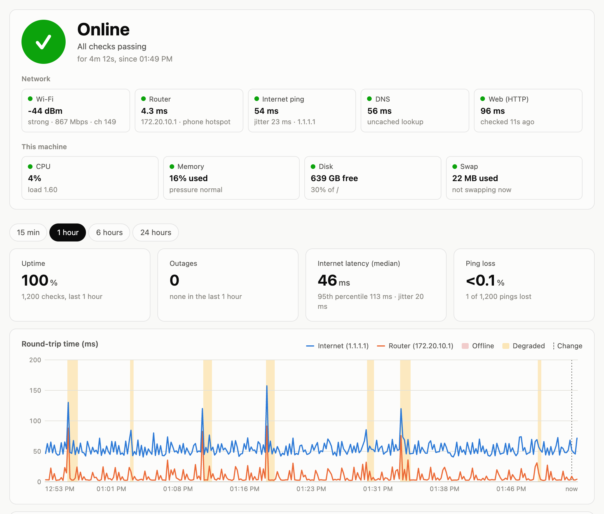

# netblame

When a video call freezes or a page won't load, netblame tells you whose fault it is: your Wi-Fi, your router, your internet provider, DNS, or your own computer.

<picture>
  <source media="(prefers-color-scheme: dark)" srcset="https://raw.githubusercontent.com/samerbuna/netblame/main/docs/screenshot-dark.png">
  
</picture>

```zsh
npx netblame
```

This starts netblame and opens its page at http://localhost:4321. Run it again while netblame is running and it just opens the page. It needs Node 22 or newer, on macOS or Linux. It has no dependencies and doesn't need sudo. I haven't tested it on a Linux machine yet.

It checks your connection every 3 seconds and keeps a week of history. The page shows whether the connection is Online, Degraded or Offline, with the reason in plain words, like "Router OK, nothing beyond it: modem or ISP problem".

## What it can tell you

- Which part is at fault: your Wi-Fi, the router, your internet provider, DNS (the lookup that turns a name like example.com into an address), or a captive portal (the sign-in page that hotel and airport Wi-Fi shows before it lets you online).
- That a working connection is bad for calls, because pings get lost, ping times jump around (jitter), or ping times climb while something uploads or downloads (bufferbloat).
- That your computer is the problem: a nearly full disk, memory pressure, a busy CPU, heavy swapping, a weak Wi-Fi signal, a low battery, or a CPU slowed down for heat.
- Which apps use the most CPU and memory, and on macOS the most network.
- What changed and when: switching networks, a VPN connecting or disconnecting, joining a phone hotspot, or waking from sleep.

## Notifications

While netblame runs, it posts a desktop notification when the connection goes Offline and again when it's back. It also posts one when the connection has been Degraded for two minutes, and when your computer has a problem. Set `NOTIFY=0` to turn them off.

## Keep it running

```zsh
npx netblame install
```

This starts netblame now and at every login, and restarts it if it crashes. It runs as a launchd agent on macOS and a systemd user service on Linux. Run `npx netblame@latest install` to upgrade it, and `npx netblame uninstall` to remove it. Uninstalling keeps your history.

## A report for your ISP

```zsh
npx netblame report
```

This prints a plain-text report of the last 7 days. You can paste it into a support chat with your ISP. It lists each outage with when it started, how long it lasted and the likely cause. It also gives the uptime, the median ping, the share of pings lost, and how much of the period netblame was running. Add `--days 3` for a shorter period. The command reads the history files, so it works while netblame is stopped.

The "Copy 7-day report for your ISP" button on the page copies the same text.

## Speed test (macOS)

The page has a speed test button that runs Apple's `networkQuality`. The test shows download and upload speed, and responsiveness, which is how quickly the connection answers while it's busy. A test uses several hundred MB of data, so it only runs when you press the button. On a phone hotspot, the page asks before it starts.

## Privacy

Your history stays on your computer, in `~/Library/Application Support/netblame` on macOS and `~/.local/state/netblame` on Linux. The checks contact your router, `1.1.1.1`, your DNS servers and `cp.cloudflare.com`. Together they use roughly 15 MB of data a day. A speed test contacts Apple's servers. There's no account and no telemetry.

The page is served only to this computer, and other websites can't read it or start a speed test.

## Settings

Set these as environment variables, for example `PORT=4322 npx netblame`. `install` keeps any settings you run it with for the login service.

| Variable | Default | What it sets |
| --- | --- | --- |
| `PORT` | `4321` | the page's port |
| `TICK_MS` | `3000` | milliseconds between check rounds |
| `PING_HOST` | `1.1.1.1` | the internet address to ping |
| `HTTP_URL` | `http://cp.cloudflare.com/generate_204` | the web check, which must return 204; keep it http so captive portals show up |
| `DNS_ZONE` | `example.com` | the domain random names are looked up under |
| `KEEP_DAYS` | `7` | days of history to keep |
| `MACHINE_MS` | `10000` | milliseconds between checks of your computer |
| `DISK_PATH` | `/` | a path on the disk whose free space is watched |
| `DATA_DIR` | see Privacy | where history is stored |
| `NOTIFY` | `1` | `0` turns notifications off |

## How it works

[How netblame works](https://github.com/samerbuna/netblame/blob/main/docs/how-it-works.md) covers each check, the rules behind Online, Degraded and Offline, the limits for your computer, and the history files.

## Development

- `npm install` installs TypeScript, which is only used for type checking.
- `npm start` runs `src/` directly, which needs Node 22.18+ or 23.6+.
- `npm test` runs the tests with `node --test`.
- `npm run check` type-checks with `tsc`.
- `npm run build` writes `dist/`, the JavaScript the npm package runs.

`src/` holds the server: the checks, the rules, history, notifications, the login service and the web server. `public/` holds the page. The page, the report and the tests share the status logic in `public/lib`. The build uses Node's own type stripper, because Node won't strip types from `.ts` files inside `node_modules`.

## License

MIT
